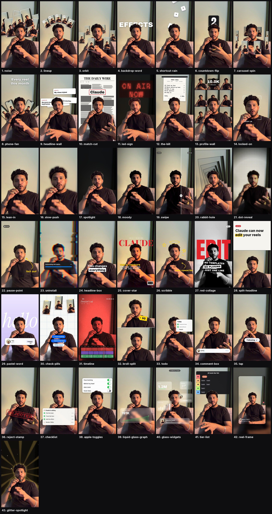

# effects-pack

**42 face-tracked video effects for Claude Code.**
Drop a talking-head clip into Claude, say which effect you want and when, and you get back an edited video with your audio untouched. No templates, no plugins, no keyframes.



---

## Install

You need [Claude Code](https://claude.com/claude-code). Paste this into a terminal:

```bash
git clone https://github.com/itsyaduvanshi/effects-pack ~/.claude/skills/effects-pack
```

On Windows (PowerShell):

```powershell
git clone https://github.com/itsyaduvanshi/effects-pack $HOME\.claude\skills\effects-pack
```

Then restart Claude Code.

> **Never used a terminal?** Open Claude Code and type:
> *"Install the skill from github.com/itsyaduvanshi/effects-pack into ~/.claude/skills/effects-pack"*
> Claude will do it for you.

### First run

The first time you use an effect, Claude sets things up (2-3 minutes, only once):

- a private Python environment inside the skill folder
- the face detector and person cut-out models
- the fonts the effects use

It needs `ffmpeg`. If you don't have it, Claude installs it for you, or tells you the one command to run.

---

## Use it

1. Open Claude Code.
2. Drag your video into the chat. A vertical phone video with your face in frame works best.
3. Ask for an effect:

```
/effects-pack orbit from 2 to 5 seconds
/effects-pack backdrop-word "SHIP IT" when I say "ship it"
/effects-pack spotlight for the first 3 seconds with the word NIGHT behind me
/effects-pack glass-widgets 0-4s, big number 1.2M, my handle is @yourname
```

Claude then:

1. finds the timing (it can listen for a word you say),
2. renders a few **check frames** and looks at them,
3. fixes anything that covers your face or runs off the edge,
4. renders `yourvideo_fx.mp4` next to the original.

### Stack several effects

Ask for them in one message:

> *"locked-on from 0 to 2s, then tier-list from 4 to 8s with Claude in S tier, then a reject stamp when I say 'no'."*

### Put your own reels in

`orbit`, `noise`, `carousel-spin`, `phone-fan`, `profile-wall`, `check-pills` and `broll-split` show reel cards. By default they use frames from your own video. To use real ones, give Claude a folder:

> *"orbit 2-5s, use the screenshots in ~/Desktop/my-reels"*

### Use real numbers

Counters, graphs, tier lists and headlines come with sample text. Tell Claude your real numbers and words, e.g. *"liquid-glass-graph from 12K to 197K, label 'views this month'"*.

---

## The effects

**Behind your head**

| Effect | What happens |
|---|---|
| `noise` | Reel cards pop up one after another and pile up behind you |
| `lineup` | Numbered tiles fan out in an arc above your head |
| `orbit` | Your reels circle your head, going behind it at the top |
| `carousel-spin` | Reels ride a 3D carousel around you and slow to a stop |
| `phone-fan` | Phones fan out from behind you under a headline |
| `backdrop-word` | A giant word springs down behind your head |
| `shortcut-rain` | Keyboard keys tumble down behind you |
| `countdown-flip` | A flip clock counts 3, 2, 1 above your head |
| `headline-wall` | Headline cards stack up behind you, then a total pops in front |
| `match-cut` | Newspaper pages cut fast while one word stays boxed in place |
| `led-sign` | The room goes dark and an LED sign types itself out behind you |
| `the-bill` | A receipt of your instructions prints down from the top |
| `profile-wall` | Your reels grid scrolls behind you while a counter ticks up |

**Camera and colour**

| Effect | What happens |
|---|---|
| `locked-on` | Brackets snap onto your face and the camera follows you |
| `lean-in` | A quick punch-in for one word |
| `slow-push` | A slow push-in while the room melts out of focus |
| `spotlight` | The lights die, you stay lit, an optional word glows behind you |
| `glitter-spotlight` | Spotlight with gold rays, a shine sweep and sparkles |
| `moody` | A colour grade (`moody`, `bw`, `warm`, `cool`, `pop`, `soft`, `film-red`) |
| `swipe` | A before/after wipe across the frame |
| `rabbit-hole` | The room tunnels into itself behind you |
| `dot-reveal` | The shot builds out of glowing dots, then snaps sharp |
| `pause-point` | Freeze frame, a flash, and a marker arrow pointing at you |
| `uninstall` | An uninstall dialog fails while the frame glitches apart |
| `headline-box` | A punch-in with a clean two-line headline |

**Full looks**

| Effect | What happens |
|---|---|
| `cover-star` | You're on a magazine cover, masthead behind your head (`look=editorial` for a classic one) |
| `red-collage` | Black and white you, a giant red word behind, three lines slam in |
| `split-headline` | A headline card slides down and pushes you to the bottom half |
| `pastel-word` | A lavender room, a big serif word, and a profile card that gets followed |
| `check-pills` | A grid-paper room, pinned reels, and a cursor ticking blue pills |
| `timeline` | A red film look with REC, a timecode and an editing timeline |
| `broll-split` | B-roll on top with a price tag, you below |
| `scribble` | Marker halo, stars and an arrow draw themselves around you |

**App-style overlays**

| Effect | What happens |
|---|---|
| `todo` | A checklist next to your head ticks off as you talk |
| `checklist` | A Claude-style task list under your chin: each step spins, then goes green |
| `apple-toggles` | iPhone switches flip on one line at a time |
| `liquid-glass-graph` | A glass card with a climbing graph and a counting number (`look=bento` for a dashboard) |
| `glass-widgets` | Frosted widgets float around your head |
| `comment-box` | An Instagram comment types itself and posts |
| `tap` | A Follow button gets tapped and flips to Following |
| `reject-stamp` | A big red stamp slams down with a camera shake |
| `tier-list` | A tier list drops in and your pick flies into S tier |
| `reel-frame` | Your video shrinks into a reel card with Instagram UI |

Every option for every effect is listed in [SKILL.md](SKILL.md).

---

## Tips

- **Short windows look best:** 1.5 to 4 seconds per effect.
- **Say timing in plain words.** "When I say 'watch this'" works; Claude finds the exact second.
- **Camera effects go first.** If `lean-in` or `spotlight` overlaps another effect, it's applied first so everything else stays in place.
- **4K:** ask for it ("render in 4K"). It takes longer.
- **Your face stays clear.** Graphics either go behind you or are placed around your face.

## If something looks off

Tell Claude what you see, in plain words:

- *"the word is covering my face"*
- *"it's too fast"*
- *"move the card to the left"*
- *"use @myhandle instead of @you"*

It changes the plan, checks the frames again and re-renders.

## What it doesn't do

- **No sound or captions.** It's visuals only, so add music, SFX and captions in your editor.
- **It drafts, you approve.** Watch the result before you post.
- **It isn't hand-animated.** These are solid starting points, not a frame-by-frame custom edit.

---

## How it works

```
video ─► ffmpeg ─► face track (YuNet, smoothed)  ─┐
                 └► person mask (MediaPipe)       ─┼─► effects (Pillow + NumPy) ─► ffmpeg ─► mp4 + original audio
```

- Analysis runs once per clip and is cached, so check frames and the final render don't repeat it.
- "Behind your head" means: draw the graphic, then paste you back on top using the person mask.

### Run it without Claude

```bash
cd ~/.claude/skills/effects-pack
bash scripts/setup.sh
.venv/bin/python scripts/fx.py --list
.venv/bin/python scripts/fx.py orbit in.mov out.mp4 --start 2 --end 5
.venv/bin/python scripts/fx.py --plan plan.json in.mov out.mp4 --still 3.0   # check frame only
.venv/bin/python scripts/sheet.py in.mov out/ --videos                      # every effect, one sheet
```

### Add your own effect

Create a file in `scripts/fxkit/`, write a function, and register it:

```python
from .base import effect

@effect('my-effect')
def my_effect(img, e):
    # img: float RGB frame (0..1). e.face, e.mask, e.t, e.p, e.opt('text') ...
    return img
```

Import the file in `scripts/fxkit/render.py` and `/effects-pack my-effect` works.

---

## Credits

Face detection: [OpenCV YuNet](https://github.com/opencv/opencv_zoo) (MIT). Person cut-out: [MediaPipe Selfie Segmenter](https://ai.google.dev/edge/mediapipe/solutions/vision/image_segmenter) (Apache 2.0). Fonts from [Google Fonts](https://fonts.google.com): Archivo Black, Instrument Serif, Space Mono, Inter, Anton, Playfair Display (SIL OFL) and Permanent Marker (Apache 2.0). These are downloaded during setup, and their licences are saved in `fonts/licenses/`.

Code: MIT, see [LICENSE](LICENSE). Made by [@itsyaduvanshi](https://github.com/itsyaduvanshi).
